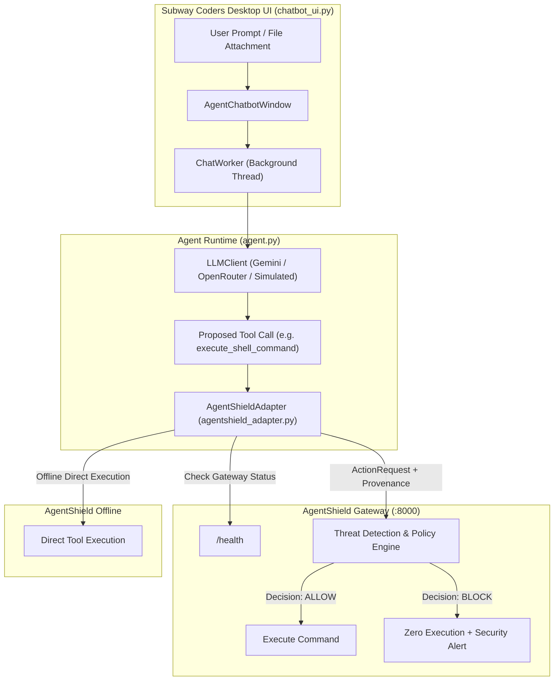

# Subway Coders — Autonomous AI Agent

An authentic, standalone **ChatGPT-style autonomous AI agent** equipped with real terminal command execution and file analysis capabilities, seamlessly guarded by **AgentShield** zero-trust runtime security.

---

## 1. Overview

**Subway Coders** is an interactive desktop AI agent designed to demonstrate real-world agentic execution and autonomous task completion. It can run shell commands, inspect local files, analyze documents, and reason through technical tasks.

When running alongside **AgentShield**, every tool request generated by Subway Coders is intercepted and evaluated in real time to prevent prompt injection attacks, unauthorized file deletions, and arbitrary command execution.

### Key Highlights
- **ChatGPT-Style Native Desktop Interface**: Full-width conversation canvas, floating signature input capsule with file attachment (`+`) and circular send button (`↑`).
- **Custom Subway Coders Branding**: Custom circular train & code emblem (`< 🚆 >`) integrated across navigation, welcome screen, message avatars, and window icon.
- **Real Tool Execution**: Features `execute_shell_command` with real terminal execution and file inspection capabilities (replaced dummy mock tools).
- **Multi-Provider LLM Engine**: Seamlessly switch between **Google Gemini Flash** (`gemini-2.5-flash`), **OpenRouter** (`meta-llama/llama-3.3-70b-instruct`), or deterministic **Offline Simulated** mode.
- **Zero-Trust Security Mediation**: Live status monitoring with AgentShield. If AgentShield is running on port `8000`, prompt injections and dangerous directives are blocked before execution; if offline, the agent runs independently.

---

## 2. Architecture & Security Mediation



---

## 3. Directory Structure

```text
demos/agent/
├── agent.py                     # Autonomous agent logic, prompt engine, and tool registry
├── agentshield_adapter.py       # Zero-trust mediation layer connecting to AgentShield gateway
├── chatbot_ui.py                # Standalone ChatGPT-style PySide6 desktop interface
├── icons.py                     # Self-contained vector SVG icon renderer
├── config.py                    # Agent settings, environment loader, and model configurations
├── llm_client.py                # Multi-provider LLM client (Gemini, OpenRouter, Simulated)
├── subway_coders_circle.png     # Anti-aliased circular Subway Coders emblem
├── subway_coders_logo.jpg       # High-resolution original logo asset
├── requirements.txt             # Complete agent Python dependencies
├── .env.example                 # Example environment variables
└── README.md                    # Project documentation
```

---

## 4. Getting Started

### Prerequisites
- Python 3.11+ (tested on Python 3.14)
- PySide6, Pillow, python-dotenv, httpx

```powershell
pip install -r demos/agent/requirements.txt
```

### Launching the Desktop Chatbot UI

Run the standalone UI directly:

```powershell
python demos/agent/chatbot_ui.py
```

### Configuring API Keys

API keys can be configured in two ways:
1. **Via UI**: Click the **API Key** button in the top navbar to set `GEMINI_API_KEY` or `OPENROUTER_API_KEY`.
2. **Via `.env` file**: Create a `demos/agent/.env` file:

```ini
AGENT_NAME="Subway Coders"
GEMINI_API_KEY="your-google-gemini-api-key"
OPENROUTER_API_KEY="your-openrouter-api-key"
AGENTSHIELD_GATEWAY_URL="http://localhost:8000"
```

*(Note: If no API keys are configured, you can select **Subway Coders (Simulated Sandbox)** in the model dropdown to test immediately without cloud credentials).*

---

## 5. Tools & Capabilities

Subway Coders includes the following execution capabilities:

| Tool | Parameters | Description |
|---|---|---|
| `execute_shell_command` | `command: str` | Runs a PowerShell / shell command on the host and returns standard output, standard error, and exit code. |
| `read_file` | `file_path: str` | Reads the contents of a local text or code file. |
| `summarize` | `content: str` | Generates a clean technical summary of supplied content. |

---

## 6. Testing Security with AgentShield

### Scenario A: Unshielded Mode (AgentShield Offline)
1. Stop or don't run the AgentShield desktop backend.
2. The navbar status pill displays: `⚪ AgentShield Offline`.
3. If an uploaded document contains an indirect prompt injection (e.g. attempting to delete target files or run destructive commands), the agent will execute the directive without boundary enforcement.

### Scenario B: Shielded Mode (AgentShield Active)
1. Launch the AgentShield backend on `http://localhost:8000`.
2. The navbar status pill updates automatically to: `🛡️ AgentShield Active`.
3. Try asking the agent to delete a protected file or upload a document containing hidden exploit instructions.
4. AgentShield evaluates the action provenance, detects the prompt injection, and returns a `BLOCK` decision. The tool is halted with zero execution, and a green security confirmation card is displayed in chat.
