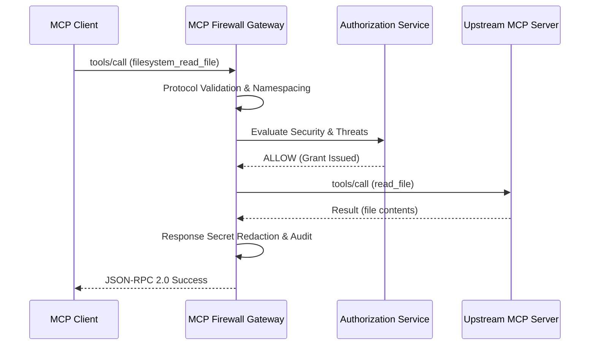
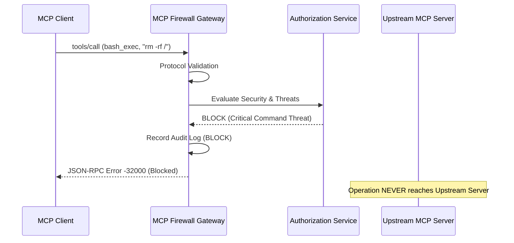
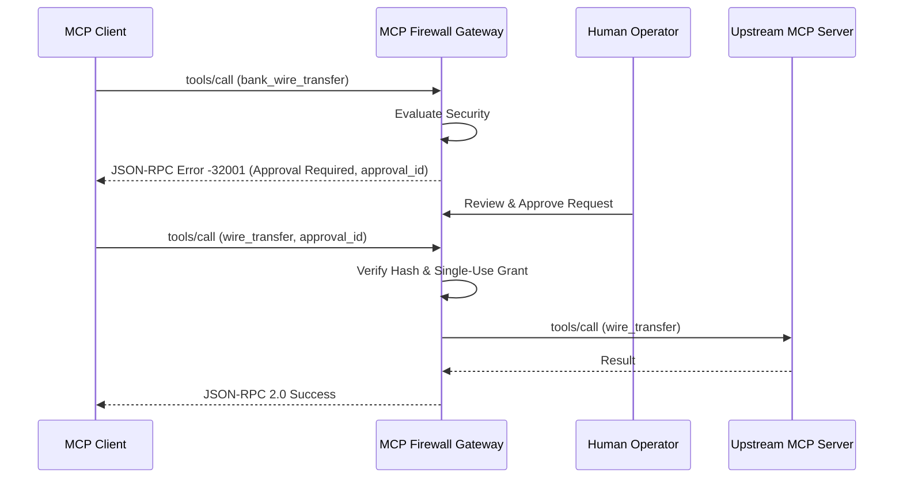

# AgentShield AI — Model Context Protocol (MCP) Firewall Gateway

## Phase 8 Specification & Implementation Guide

---

## 1. Overview

**AgentShield AI MCP Firewall Gateway** is a protocol-level security enforcement layer positioned between AI agents (acting as MCP clients) and external upstream MCP servers. It mediates, analyzes, and controls all Model Context Protocol operations to enforce zero-trust security boundaries.

External MCP servers grant agents direct access to operating systems, filesystems, databases, APIs, and cloud services. The MCP Firewall Gateway ensures that **no untrusted or unauthorized MCP operation reaches upstream servers without rigorous security evaluation**.

```
┌─────────────────┐       JSON-RPC 2.0       ┌──────────────────────────────────────────────┐       Managed Transport       ┌────────────────────────┐
│   MCP Client    │ ────────────────────────> │          AgentShield MCP Gateway             │ ────────────────────────────> │  Upstream MCP Server   │
│ (AI Agent / SDK)│ <──────────────────────── │ 1. Protocol Validation                       │ <──────────────────────────── │ (Filesystem / DB / API)│
└─────────────────┘                           │ 2. Tenant Isolation & Auth                   │                               └────────────────────────┘
                                              │ 3. Discovery & Namespacing                   │
                                              │ 4. Threat Detection (Phase 5)                │
                                              │ 5. Decision Engine (Phase 4)                 │
                                              │ 6. Response Secret Redactor                  │
                                              │ 7. Audit Logging                             │
                                              └──────────────────────────────────────────────┘
```

---

## 2. Core Architecture & Pipeline

Every MCP message routed through the gateway passes through a sequential 7-stage security pipeline:

1. **Protocol Validation:**
   - Validates JSON-RPC 2.0 framing (`jsonrpc == "2.0"`).
   - Validates method support (`initialize`, `ping`, `tools/list`, `tools/call`, `resources/list`, `resources/read`, `prompts/list`, `prompts/get`).
   - Rejects malformed JSON, invalid structures, or forbidden RPC methods with standard protocol error codes.

2. **Tenant Isolation & Server Authentication:**
   - Server registration is strictly partitioned by `user_id` (tenant).
   - Verifies upstream server enablement (`is_enabled`) and connection state.
   - Unauthorized tenant access attempts are rejected immediately with `404 Not Found`.

3. **Discovery Firewall & Tool Namespacing:**
   - Upstream `tools/list` responses are intercepted before reaching the client.
   - All tools are dynamically namespaced: `<server_prefix>_<original_tool_name>`.
   - Collisions between servers with identically named tools are deterministically resolved (`_1`, `_2`).
   - Descriptions and schemas are inspected to neutralize embedded prompt injections.

4. **Security Policy & Threat Detection:**
   - Adapts operations to AgentShield `ActionRequest` contracts.
   - Executes Phase 5 Threat Detection Coordinator (`DataLeakageDetector`, `CommandInjectionDetector`, `FilesystemDetector`, `PromptInjectionDetector`).
   - Evaluates active tenant policies in the Phase 4 Core Security Decision Engine.

5. **Decision Enforcement:**
   - **`ALLOW`:** Issues a short-lived single-use authorization grant; forwards the operation upstream.
   - **`BLOCK`:** Halts the operation; returns JSON-RPC error code `-32000`; **never forwards to upstream server**.
   - **`ASK_HUMAN`:** Halts operation; records an `ApprovalRequest` with canonical argument hash; returns JSON-RPC error `-32001` with `approval_id`; **never forwards until human approves**.

6. **Upstream Response Inspection & Sanitization:**
   - Inspects payloads returned by upstream external servers.
   - Evaluates size limits against `max_response_size_bytes`.
   - Auto-redacts leaked API keys (OpenAI, Anthropic, AWS), private keys, Bearer tokens, passwords, and sensitive credentials.

7. **Audit Logging & Activity Tracking:**
   - Intercepted operations are recorded in the `mcp_activities` table with execution duration, outcome decisions, redaction flags, and threat counts.

---

## 3. Transports & Security Controls

### 3.1 STDIO Subprocess Transport

Local MCP servers launched via standard input/output subprocesses are subject to strict host defense controls:
- **Executable Whitelist:** Only pre-approved binary executables may be spawned: `python`, `python3`, `node`, `npx`, `uvx`, `docker`.
- **No Arbitrary Shell Invocation:** Subprocesses are launched directly using `asyncio.create_subprocess_exec` (`shell=False`).
- **Environment Sanitization:** Strips sensitive AgentShield host secrets (`AGENTSHIELD_*`) from child process environments.

### 3.2 Streamable HTTP & SSE Transport

Remote MCP endpoints are mediated over HTTP/SSE with anti-SSRF defenses:
- **SSRF Prevention:** Rejects private IPv4/IPv6 address ranges (`127.0.0.0/8`, `10.0.0.0/8`, `172.16.0.0/12`, `192.168.0.0/16`, `169.254.0.0/16`, `::1/128`, `fc00::/7`).
- **Payload Caps:** Enforces strict 10MB limits on inbound requests and upstream responses.
- **Connection Timeouts:** Configurable connection and socket read timeouts.

---

## 4. Sequence Diagrams

### 4.1 Authorized Tool Call (`ALLOW`)



### 4.2 Blocked Dangerous Operation (`BLOCK`)



### 4.3 Human-in-the-Loop Approval (`ASK_HUMAN`)



---

## 5. REST API Endpoints

All endpoints are mounted under `/api/v1/mcp`:

| Method | Endpoint | Description |
|---|---|---|
| `POST` | `/api/v1/mcp/servers` | Register upstream MCP server (enforces whitelist & SSRF checks). |
| `GET` | `/api/v1/mcp/servers` | List tenant registered MCP servers. |
| `GET` | `/api/v1/mcp/servers/{server_id}` | Get server configuration details. |
| `PATCH` | `/api/v1/mcp/servers/{server_id}` | Update server enabled status or description. |
| `DELETE` | `/api/v1/mcp/servers/{server_id}` | Delete server registration. |
| `POST` | `/api/v1/mcp/servers/{server_id}/connect` | Perform initialization handshake and test connection. |
| `POST` | `/api/v1/mcp/servers/{server_id}/disconnect` | Disconnect active upstream session. |
| `GET` | `/api/v1/mcp/servers/{server_id}/tools` | Discover tools with gateway namespacing. |
| `GET` | `/api/v1/mcp/activities` | Intercepted activity audit log. |
| `POST` | `/api/v1/mcp/gateway/{server_id}/message` | Primary JSON-RPC 2.0 firewall gateway mediation endpoint. |

---

## 6. PySide6 Desktop Integration

The desktop application includes a dedicated **MCP Firewall Gateway** interface in the **Integrations & Protocol Gateways** view (`apps/desktop/views/mcp_gateway.py`):
- **Live Summary Cards:** Active MCP Servers, Discovered Namespaced Tools, Mediated Calls, Intercepted Threats.
- **Upstream Server Registry Table:** Server name, transport mechanism, endpoint/command, trust classification, connection status, and last handshake timestamp.
- **Protocol Firewall Activity Table:** Real-time audit trail of intercepted calls, decisions (`ALLOW`, `BLOCK`, `ASK_HUMAN`), execution status, and secret redaction badges.
