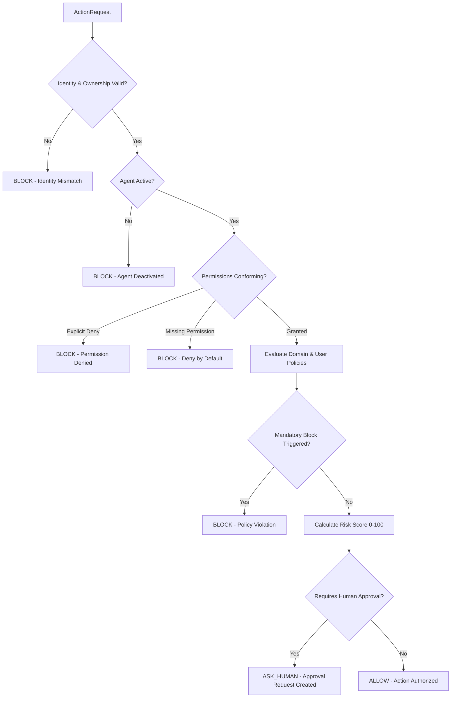

# AgentShield AI — Security Decision Engine

## Overview

The AgentShield Core Security Engine provides independent, deterministic, and explainable runtime authorization for AI agent tool invocations.

The engine evaluates actions without relying on an LLM or the agent's own safety claims.

---

## Evaluation Flow

---

## Core Tenets

1. **Deny by Default:** Unless an action is explicitly granted in the agent's permission profile, it is denied.
2. **Explicit Deny Overrides Allow:** Deny configurations take absolute precedence.
3. **Mandatory Block Precedence:** High-severity policy violations cannot be bypassed by an allow rule or converted into an approval request.
4. **Decision Precedence:** `BLOCK` > `ASK_HUMAN` > `ALLOW`.
5. **Fail-Closed Guarantee:** Any unexpected runtime evaluation failure catches the exception, logs securely without leaking secrets, and returns an immediate safe `BLOCK` decision.
