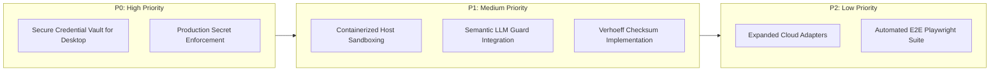

# AgentShield AI — Remediation & Stage 2 Roadmap

**Audit Date:** November 24, 2026  
**Auditor:** Antigravity Automated Verification System  
**Stage:** Stage 1 Post-Development Remediation Planning  
**Target Version:** AgentShield v0.1.0  
**Status:** **READY FOR STAGE 2 PLANNING**

---

## 1. Overview

This roadmap defines the prioritized, actionable remediation and enhancement tasks identified during the Stage 1 comprehensive audit. In accordance with the Stage 1 audit instructions, **no code has been modified during this inspection**. 

The recommendations below are organized by priority tier (P0, P1, P2) for execution in Stage 2.

---

## 2. Prioritized Roadmap Items

### 2.1 Priority Tier P0 (Immediate Pre-Production Hardening)

#### Item P0.1: Desktop Keyring / Persistent Auth Store
- **Context:** The desktop client gracefully handles offline mode, but currently lacks automatic key storage when connecting to a remote, authenticated FastAPI instance.
- **Proposed Solution:** Implement `keyring` integration in `apps/desktop/services/auth_store.py` to securely persist encrypted JWT tokens and tenant configurations across desktop app restarts.
- **Effort Estimate:** 1–2 days.

#### Item P0.2: Strict Production Secret Enforcement
- **Context:** `Settings` provides developer-friendly defaults for `SECRET_KEY` and `DATABASE_URL`.
- **Proposed Solution:** Introduce a strict boot-time validator in `apps/api/main.py` that raises a fatal initialization exception if `ENVIRONMENT=production` and `SECRET_KEY` matches any known default or short string.
- **Effort Estimate:** 0.5 days.

---

### 2.2 Priority Tier P1 (Architectural & Algorithmic Enhancements)

#### Item P1.1: Containerized Host Sandbox (Docker / gVisor Harness)
- **Context:** As documented in `security-boundary-assessment.md` and `docs/DIRECT_BYPASS_LIMITATIONS.md`, an uninstrumented agent with raw shell privileges can bypass Python-level hooks.
- **Proposed Solution:** Provide an optional Dockerized agent runner with locked-down network namespaces (`iptables` redirecting all outbound TCP traffic to the AgentShield proxy port 8000).
- **Effort Estimate:** 3–4 days.

#### Item P1.2: Hybrid Semantic Guardrails (LLM-as-a-Judge)
- **Context:** High-throughput regex heuristics are extremely fast (<3ms) but cannot comprehend deeply convoluted natural language rephrasings.
- **Proposed Solution:** Add an asynchronous, secondary evaluation hook to call a lightweight local model (e.g. Llama-Guard-3 / Gemma-2B) or remote API for ambiguous tool inputs ($0.4 \le \text{Risk} \le 0.6$).
- **Effort Estimate:** 2–3 days.

#### Item P1.3: Verhoeff Checksum Integration
- **Context:** Build Guide compliance completeness.
- **Proposed Solution:** Add the Verhoeff algorithm in `agentshield.threat_detection.detectors.data_leakage` alongside the existing Luhn algorithm.
- **Effort Estimate:** 0.5 days.

---

### 2.3 Priority Tier P2 (Ecosystem & Operational Tooling)

#### Item P2.1: Additional Cloud Agent Adapters
- **Context:** AgentShield supports Claude SDK, LangGraph, CrewAI, Google ADK, OpenAI Agents, and generic Python SDKs.
- **Proposed Solution:** Add pre-built connectors for Microsoft AutoGen and AWS Bedrock Agents.
- **Effort Estimate:** 2 days.

#### Item P2.2: Automated End-to-End GUI Testing with pytest-qt
- **Context:** Desktop UI components are covered with unit tests, but full end-to-end user workflows (clicking approve in UI, observing real-time table updates) should be simulated with headless Qt runners.
- **Effort Estimate:** 2 days.

---

## 3. Transition Plan to Stage 2

1. **Approval Gate:** Receive user confirmation on the Stage 1 audit findings and risk register.
2. **Phase Kickoff:** Begin implementation of P0 tasks (Desktop Auth Store & Production Secret Enforcement).
3. **Continuous Verification:** Re-execute the 392 automated tests after each Stage 2 improvement.
